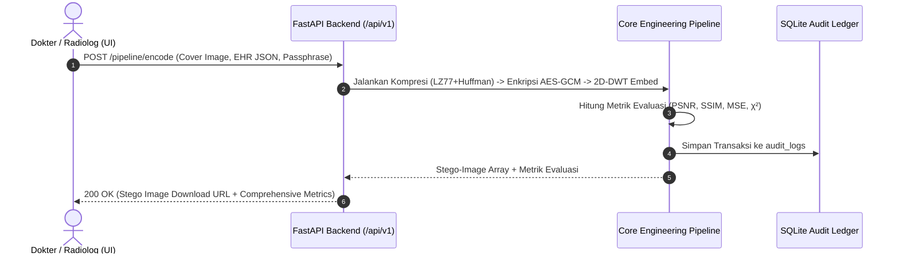

# API Specification & Communication Contracts (API)
## MedCrypt-Vault: RESTful Endpoints & Data Contracts

---

### 1. API Architecture Overview

Backend MedCrypt-Vault dibangun menggunakan **FastAPI** (Python 3.12) yang menyediakan RESTful API berkinerja tinggi berbasis asynchronous I/O, dilengkapi validasi skema otomatis melalui **Pydantic v2**.

- **Base URL:** `http://127.0.0.1:8000/api/v1`
- **Format Pertukaran Data:** `application/json` (Metadata & Kontrak) dan `multipart/form-data` (Upload Berkas Citra Medis).
- **Format Standar Respon Kesalahan:** Mengikuti spesifikasi **RFC 7807** (*Problem Details for HTTP APIs*).



---

### 2. Endpoint Specifications

#### 2.1. `POST /api/v1/pipeline/encode`
Mengompresi data rekam medis pasien, mengenkripsinya dengan AES-256-GCM, dan menyisipkannya ke dalam sub-band DWT citra medis pembawa.

- **Content-Type:** `multipart/form-data`
- **Request Parameters:**
  - `cover_image` (*File, required*): Berkas citra medis pembawa (PNG/TIFF/BMP).
  - `ehr_payload` (*String JSON / File, required*): Dokumen data rekam medis pasien.
  - `passphrase` (*String, required*): Kunci otorisasi rahasia dokter (minimal 8 karakter).
  - `quantization_step` (*Integer, optional*): Langkah kuantisasi DWT $\Delta$ (default: `4`, range: `2` - `8`).

- **Sample JSON Response (200 OK):**
```json
{
  "status": "success",
  "message": "Data rekam medis berhasil dikompresi, dienkripsi, dan disisipkan.",
  "data": {
    "stego_image_url": "/api/v1/download/stego_20261121_092833.png",
    "compression_metrics": {
      "raw_size_bytes": 9420,
      "compressed_size_bytes": 3108,
      "reduction_percentage": 67.01,
      "compression_ratio": 3.03,
      "payload_shannon_entropy": 7.984
    },
    "image_quality_metrics": {
      "image_dimensions": [1024, 1024],
      "mse": 0.3421,
      "psnr_db": 42.788,
      "ssim": 0.9984,
      "clinical_verdict": "SANGAT BAIK (Bebas Distorsi Klinis)"
    },
    "forensic_metrics": {
      "chi_square_statistic": 41.23,
      "p_value": 0.884,
      "steganalysis_status": "LOLOS (Tidak Terdeteksi Anomali)"
    },
    "security_metadata": {
      "cipher": "AES-256-GCM",
      "kdf": "PBKDF2-HMAC-SHA256 (600.000 iterasi)",
      "sha256_hash": "e3b0c44298fc1c149afbf4c8996fb92427ae41e4649b934ca495991b7852b855"
    }
  }
}
```

---

#### 2.2. `POST /api/v1/pipeline/extract`
Mengekstrak muatan biner tersembunyi dari citra stego, memvalidasi tag autentikasi, mendekripsi dengan AES-GCM, mendekompresi dengan Canonical Huffman + LZ77, dan memverifikasi integritas checksum SHA-256.

- **Content-Type:** `multipart/form-data`
- **Request Parameters:**
  - `stego_image` (*File, required*): Berkas citra stego yang memuat rekam medis.
  - `passphrase` (*String, required*): Kunci otorisasi rahasia dokter.

- **Sample JSON Response (200 OK):**
```json
{
  "status": "success",
  "message": "Ekstraksi dan autentikasi berhasil. Data pasien terverifikasi utuh.",
  "integrity": {
    "sha256_verified": true,
    "bit_error_rate_percent": 0.0,
    "auth_tag_verified": true
  },
  "patient_record": {
    "patient_id": "PX-992014-UHAMKA",
    "patient_name": "Ahmad Fauzi",
    "nik": "3171012304950001",
    "examination_date": "2026-11-21",
    "examining_doctor": "Dr. Dimas Febriawan, Sp.Rad",
    "clinical_diagnosis": "Infiltrat pada lapang bawah paru kanan suspek Bronkopneumonia.",
    "prescription": [
      {"medicine": "Azithromycin 500mg", "dosage": "1x1 tab p.c.", "duration": "5 hari"},
      {"medicine": "N-Acetylcysteine 200mg", "dosage": "3x1 tab p.c.", "duration": "5 hari"}
    ],
    "notes": "Kontrol ulang radiologi toraks 7 hari pasca terapi antibiotik."
  }
}
```

- **Sample Error Response (401 Unauthorized - Kunci Salah / Manipulasi Bit):**
```json
{
  "type": "https://medcrypt-vault.local/errors/authentication-failed",
  "title": "Autentikasi Kriptografis Gagal",
  "status": 401,
  "detail": "Tag otentikasi AES-GCM tidak valid. Passphrase dokter salah atau berkas citra telah mengalami manipulasi bit.",
  "instance": "/api/v1/pipeline/extract"
}
```

---

#### 2.3. `POST /api/v1/forensics/compare`
Membandingkan citra cover asli dengan citra stego secara mendalam untuk keperluan audit forensik dan visualisasi selisih piksel.

- **Content-Type:** `multipart/form-data`
- **Request Parameters:**
  - `cover_image` (*File, required*)
  - `stego_image` (*File, required*)

- **Sample JSON Response (200 OK):**
```json
{
  "status": "success",
  "metrics": {
    "mse": 0.3421,
    "psnr_db": 42.788,
    "ssim": 0.9984,
    "entropy_cover": 7.421,
    "entropy_stego": 7.424,
    "entropy_difference": 0.003
  },
  "chi_square_analysis": {
    "cover_p_value": 0.912,
    "stego_p_value": 0.884,
    "detection_threshold": 0.05,
    "verdict": "LOLOS UJI FORENSIK (Tidak Ditemukan Indikasi Steganografi LSB)"
  },
  "visualization_urls": {
    "difference_map_url": "/api/v1/forensics/diff_map_amplified.png",
    "dwt_subband_url": "/api/v1/forensics/dwt_subbands.png"
  }
}
```

---

#### 2.4. `GET /api/v1/audit/logs`
Mengambil riwayat transaksi audit ledger lokal untuk pelaporan karya tulis / presentasi.

- **Query Parameters:** `limit` (default: 50), `offset` (default: 0).
- **Response (200 OK):** Array dari objek audit log sesuai skema `audit_logs`.
