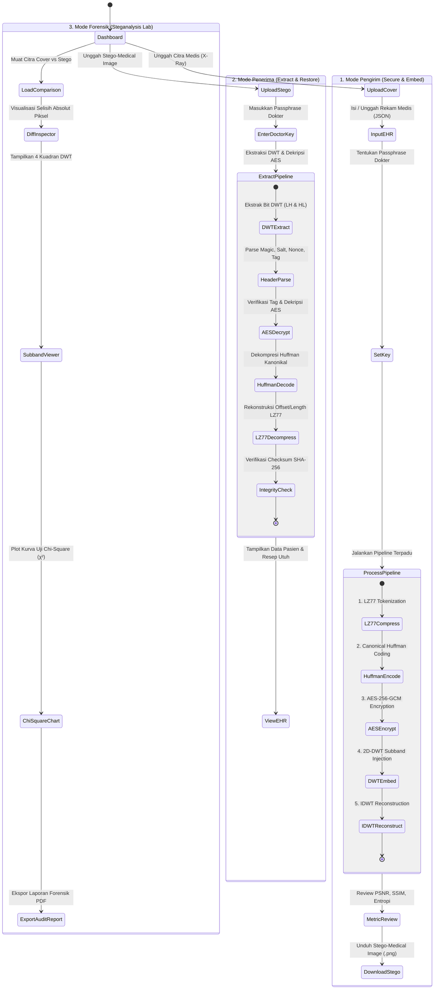

# Application Flow & User Journey (APP_FLOW)
## MedCrypt-Vault: User Interaction & State Transitions (with shadcn/ui Components)

---

### 1. High-Level User Journeys

Aplikasi MedCrypt-Vault memiliki 3 mode alur kerja utama yang dapat diakses melalui komponen navigation tabs:
1. **Journey 1: Dokter / Admin Pengirim (Encoding & Embedding Pipeline)**
2. **Journey 2: Dokter / Klinik Rujukan Penerima (Extraction & Verification Pipeline)**
3. **Journey 3: Auditor Forensik & Evaluator Akademik (Forensic Analytics & Metric Inspector)**

---

### 2. Detailed Step-by-Step Screen Flows (Mmapped to shadcn/ui Components)

Antarmuka MedCrypt-Vault dibangun di atas fondasi desain **Medical PACS Workstation** bernuansa *Dark Slate* modern, memanfaatkan komponen resmi dari [shadcn/ui](https://ui.shadcn.com/) yang berbasis Radix UI Primitives dan Tailwind CSS.

#### Screen 1: Top Navigation Bar & Global Status Bar
- **shadcn/ui Components:**
  - `Badge` (varian `outline` dan `success`): Menampilkan status koneksi backend (`FastAPI Online`), versi engine (`v1.0.0`), dan indikator memori.
  - `Tabs` & `TabsList` dengan `TabsTrigger`:
    - Tab 1: `[🔒 Secure & Embed]`
    - Tab 2: `[🔓 Extract & Restore]`
    - Tab 3: `[📊 Forensic & Quality Lab]`
  - `Button` (varian `ghost` dengan ikon `lucide-react` `Activity`, `FileText`, `Moon`, `Sun`): Toggle mode tema dan pintasan dokumentasi.

---

#### Screen 2: Workflow Tab 1 — Encode & Embed
1. **Langkah 1: Unggah Citra Medis Pembawa (*Cover Image*)**
   - **shadcn/ui Components:** `Card`, `CardHeader`, `CardTitle`, `CardDescription`, `CardContent`.
   - Area Drag-and-Drop dengan border dashed (`border-dashed border-slate-700 hover:border-cyan-500`).
   - Pratinjau Citra Instan dengan aspek rasio tetap.
   - **Metadata Preview (`Badge` & `Table`):**
     - Resolusi: `512 x 512 x 1` (Grayscale 8-bit).
     - Entropi Shannon Awal ($\mathcal{H}_{\text{cover}}$): `7.41 bit/pixel`.
     - Kapasitas Maksimum Embedding Sub-band $LH+HL$: `16.384 Byte` (131.072 bit).

2. **Langkah 2: Masukkan Data Rekam Medis Pasien (*EHR Payload*)**
   - **shadcn/ui Components:** `Card`, `Input`, `Label`, `Textarea`, `Tabs` (opsi: Form Manual vs JSON Upload).
   - Field: NIK Pasien, Nama Lengkap, Dokter Penanggung Jawab, Diagnosa Medis (ICD-10), Tindakan, dan Resep Obat.
   - Indikator Ukuran Data Mentah: `Badge` kuning `Ukuran Asli: 9.420 Byte`.

3. **Langkah 3: Konfigurasi Keamanan (*Doctor's Passphrase & Stego Params*)**
   - **shadcn/ui Components:** `Input` (tipe password dengan eye toggle `lucide-react`), `Slider` kuantisasi $\Delta$, `Tooltip`.
   - Password strength meter interaktif berbasis entropi karakter.
   - `Slider` Step Kuantisasi: $\Delta = 4$ (rentang $2 - 6$, dengan label *Low Distortion* vs *High Robustness*).

4. **Langkah 4: Tombol Eksekusi & Pipeline Progress**
   - **shadcn/ui Components:** `Button` (varian `default` dengan efek glow cyan), `Progress`, `Sonner` toast.
   - Tombol: `[🚀 Jalankan Pipeline MedCrypt-Vault]`.
   - *Progress Stepper Animation:*
     - `Progress` bar terisi bertahap:
       - 20%: *LZ77 Sliding Window Compression*
       - 40%: *Canonical Huffman Frequency Coding*
       - 60%: *PBKDF2 Key Derivation & AES-256-GCM Encryption*
       - 80%: *2D Haar DWT Sub-band Coefficient Injection*
       - 100%: *Inverse DWT (IDWT) Reconstruction & Verification*

5. **Langkah 5: Ringkasan Hasil & Download Stego Image**
   - **shadcn/ui Components:** `Card`, `Table`, `Badge` (warna hijau emerald), `Button` download.
   - **Tabel Efisiensi Kompresi:**
     - Ukuran Mentah: `9.420 Byte` $\to$ Ukuran Terkompresi: `3.108 Byte` (**Penyusutan 67.0% / Rasio 3.03:1**).
     - Shannon Entropy Payload: `7.98 bit/byte` (mendekati batas teoritis $8.0$).
   - **Tabel Evaluasi Citra:**
     - MSE: `0.34`, PSNR: `42.81 dB` (`Badge` *Excellent Quality* $\ge 40\text{ dB}$).
     - SSIM: `0.9984` (`Badge` *Identical Structure* $\ge 0.990$).
     - Bit Error Rate (BER): `0.00%` (`Badge` *Lossless Recovery*).
   - Tombol Aksi: `[📥 Unduh Stego-Medical Image (.png)]` (menyimpan citra PNG lossless 16-bit/8-bit).

---

#### Screen 3: Workflow Tab 2 — Extract & Restore
1. **Langkah 1: Unggah Citra Stego**
   - **shadcn/ui Components:** `Card`, Drag-and-drop zone.
   - Memuat citra PNG hasil steganografi.

2. **Langkah 2: Masukkan Passphrase Otorisasi Dokter**
   - **shadcn/ui Components:** `Input`, `Label`, `Button`.
   - Dokter memasukkan passphrase rahasia yang digunakan saat enkripsi.

3. **Langkah 3: Eksekusi Dekripsi & Rekonstruksi**
   - **shadcn/ui Components:** `Button`, `Sonner` toast notifications, `Dialog`.
   - Klik `[🔓 Bongkar & Verifikasi Integritas Data]`.
   - **Respon Sistem:**
     - **Sukses:** `Sonner.success("Autentikasi Sukses — Hash SHA-256 Cocok 100%")`.
       - Menampilkan modal `Dialog` atau `Card` berisi formulir resume rekam medis pasien yang rapi, lengkap dengan tanda tangan digital dokter dan riwayat diagnosa.
     - **Gagal (Salah Password atau Citra Dimodifikasi):** `Sonner.error("Autentikasi Gagal — GCM Authentication Tag Mismatch")`.
       - Layar tetap terkunci, data tidak bocor, dan log keamanan dicatat.

4. **Langkah 4: Ekspor Rekam Medis**
   - **shadcn/ui Components:** `Button` (ikon `Download`, `Printer`).
   - Unduh salinan berkas medis dalam format JSON atau cetak PDF ringkasan klinis.

---

#### Screen 4: Workflow Tab 3 — Forensic & Quality Lab
- **shadcn/ui Components:** `Tabs`, `Card`, `Slider`, `Badge`, `Table`, dan visualisasi grafik `Recharts`.
1. **Side-by-Side Image Diff Viewer:**
   - Menampilkan Citra Asli (kiri) vs Citra Stego (kanan) dengan interaktif split slider (`Slider`).
   - Tampilan *Amplified Difference Map* ($|I - I'| \times 20$) untuk mengekspos perubahan koefisien di frekuensi tinggi ($LH$ & $HL$) dan membuktikan bahwa sub-band $LL$ tetap murni $0$ selisihnya.
2. **2D-DWT Sub-band Decomposition Explorer:**
   - Visualisasi matriks 4 kuadran: $LL$ (Approximation), $LH$ (Horizontal Details), $HL$ (Vertical Details), $HH$ (Diagonal Details).
3. **Chi-Square ($\chi^2$) Steganalysis Curve:**
   - Grafik interaktif `Recharts` (`LineChart`, `ResponsiveContainer`, `XAxis`, `YAxis`, `Tooltip`, `Legend`).
   - Menampilkan probabilitas deteksi terhadap persentase sampel citra; kurva berada di bawah ambang batas $p > 0.05$ (membuktikan ketahanan terhadap serangan steganalsis orde pertama).
4. **Histogram Komparatif:**
   - Grafik batang `Recharts` (`BarChart`) menunjukkan distribusi intensitas piksel sebelum dan sesudah embedding yang saling berhimpit secara sempurna.

---

### 3. Penanganan Kasus Khusus (Edge Cases & Error Handling)

| Kasus Khusus | Deteksi Sistem | Respon & Solusi UI (shadcn/ui) |
| :--- | :--- | :--- |
| **Payload Melebihi Kapasitas Citra** | $\text{Payload Bits} > \frac{W \times H}{4}$ | `Dialog` peringatan kapasitas berlebih dengan `Badge` destructive. Menyarankan resolusi citra lebih tinggi atau optimasi kompresi. |
| **Passphrase Salah saat Ekstraksi** | AES-GCM Authentication Tag mismatch | `Sonner.error` instan dengan teks peringatan merah. Layar tidak menampilkan fragmen data apa pun (mencegah *oracle attack*). |
| **Citra Stego Rusak / Termutilasi** | Magic byte bukan `MCVT` atau SHA-256 gagal | `Card` error merah dengan pesan *“Berkas Corrupt / Termodifikasi di Perjalanan”*. Menjamin integritas data medis. |
| **Citra Grayscale vs Citra Berwarna** | Dimensi matriks ($2D$ vs $3D$) | Otomatis menyesuaikan DWT: jika RGB, embedding dilakukan pada kanal Luminansi ($Y$) dari ruang warna YCbCr agar warna visual tidak bergeser. |
