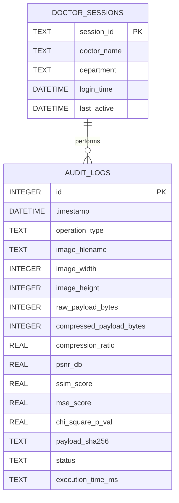

# Database Architecture & Audit Schema (DATABASE)
## MedCrypt-Vault: Local Persistence & Forensic Audit Ledger

---

### 1. Database Philosophy & Privacy Principles

Sebagai sistem yang mematuhi standar privasi data medis (**UU PDP No. 27/2022 & HIPAA**), MedCrypt-Vault menganut prinsip arsitektur **Zero-Plaintext Storage**:
- **Data sensitif pasien (NIK, nama, diagnosa klinis, resep obat) TIDAK PERNAH disimpan dalam bentuk plaintext di disk basis data lokal.**
- Basis data lokal berfungsi eksklusif sebagai **Buku Besar Audit Forensik (*Forensic Audit Ledger*)** yang mencatat metadata teknis operasi: waktu proses, metrik kompresi (rasio kompresi, pengurangan byte), metrik distorsi citra (PSNR, SSIM, MSE), serta hash kriptografis SHA-256 untuk pembuktian integritas non-repudiasi.

---

### 2. Database Engine & Configuration

- **Engine:** **SQLite 3** tertanam (*embedded*), tidak memerlukan konfigurasi server database eksternal.
- **Mode Konkurensi:** **Write-Ahead Logging (WAL Mode)** (`PRAGMA journal_mode=WAL;`) untuk memungkinkan pembacaan dan penulisan konkuren berkecepatan tinggi tanpa lock contention.
- **Lokasi Berkas:** `data/medcrypt_audit.db`.

---

### 3. Entity Relationship & Schema Definitions



#### 3.1. DDL: Tabel `audit_logs`
Menyimpan riwayat setiap proses kompresi-penyisipan dan ekstraksi yang dilakukan:

```sql
CREATE TABLE IF NOT EXISTS audit_logs (
    id INTEGER PRIMARY KEY AUTOINCREMENT,
    timestamp DATETIME DEFAULT CURRENT_TIMESTAMP,
    operation_type TEXT NOT NULL CHECK(operation_type IN ('ENCODE', 'DECODE')),
    image_filename TEXT NOT NULL,
    image_width INTEGER NOT NULL,
    image_height INTEGER NOT NULL,
    raw_payload_bytes INTEGER,
    compressed_payload_bytes INTEGER,
    compression_ratio REAL,
    psnr_db REAL,
    ssim_score REAL,
    mse_score REAL,
    chi_square_p_val REAL,
    payload_sha256 TEXT NOT NULL,
    status TEXT NOT NULL CHECK(status IN ('SUCCESS', 'CAPACITY_EXCEEDED', 'AUTH_FAILED', 'CORRUPT_DATA')),
    execution_time_ms REAL NOT NULL
);

-- Index untuk mempercepat query riwayat audit
CREATE INDEX idx_audit_timestamp ON audit_logs(timestamp);
CREATE INDEX idx_audit_status ON audit_logs(status);
```

#### 3.2. DDL: Tabel `doctor_sessions`
Mencatat sesi dokter radiologi yang sedang aktif menjalankan sistem:

```sql
CREATE TABLE IF NOT EXISTS doctor_sessions (
    session_id TEXT PRIMARY KEY,
    doctor_name TEXT NOT NULL,
    department TEXT NOT NULL DEFAULT 'Radiology',
    login_time DATETIME DEFAULT CURRENT_TIMESTAMP,
    last_active DATETIME DEFAULT CURRENT_TIMESTAMP
);
```

---

### 4. Kebijakan Retensi & Pembersihan Data (*Data Retention & Purging*)

1. **Audit Logs:** Data log teknis dipertahankan selama masa perkuliahan/evaluasi akademik untuk keperluan demonstrasi dosen dan pengujian performa.
2. **Pembersihan Otomatis (*Auto-Purge*):** Tersedia perintah pembersihan riwayat (`medcrypt-cli purge-logs`) yang menghapus seluruh log audit sebelum pengujian fungsional baru.
3. **Backup Portabel:** Berkas `medcrypt_audit.db` dapat disalin atau diekspor ke format CSV/Excel untuk dianalisis pada laporan karya ilmiah tugas akhir.
