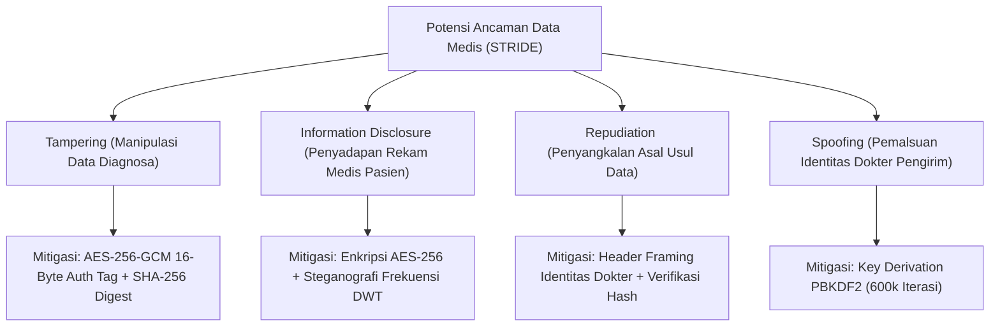

# Security & Cryptographic Architecture (SECURITY)
## MedCrypt-Vault: Data Privacy, Encryption & Regulatory Compliance

---

### 1. Threat Model & Security Posture (STRIDE)

Data Rekam Medis Elektronik (*Electronic Health Record* / EHR) merupakan data berkategori sangat sensitif (*highly confidential personal data*). MedCrypt-Vault memetakan ancaman keamanan berdasarkan model **STRIDE**:

---

### 2. Cryptographic Architecture Specifications

#### 2.1. Standar Enkripsi Simetris: AES-256-GCM (AEAD)
- **Algoritma:** *Advanced Encryption Standard* (AES) dalam mode *Galois/Counter Mode* (GCM).
- **Panjang Kunci:** 256 bit ($32\text{ byte}$).
- **Initialization Vector (IV) / Nonce:** 96 bit ($12\text{ byte}$), dibangkitkan secara kriptografis acak menggunakan generator entropi sistem operasi (`os.urandom(12)`). Setiap citra stego yang dihasilkan dijamin memiliki IV yang unik (*never reuse an IV*).
- **Authentication Tag:** 128 bit ($16\text{ byte}$). Tag ini memvalidasi keaslian ciphertext sebelum didekripsi. Jika penyerang mengubah bahkan 1 bit saja pada koefisien DWT citra, proses dekripsi akan langsung gagal (*tamper detection*).

#### 2.2. Penurunan Kunci (*Key Derivation Function* / KDF)
Untuk mencegah serangan kamus (*dictionary attack*) dan *rainbow table* terhadap kata sandi dokter:
- **Primitif:** **PBKDF2-HMAC-SHA256**.
- **Jumlah Iterasi:** **$600.000\text{ iterasi}$** (sesuai rekomendasi OWASP terbaru).
- **Garam Kriptografi (*Salt*):** 128 bit ($16\text{ byte}$) acak murni yang dibangkitkan secara unik untuk setiap sesi proses kompresi.

#### 2.3. Integritas Data Ganda (Dual Verification Layer)
1. **Lapisan 1 (Kriptografis):** Tag autentikasi AES-GCM 16-byte memverifikasi bahwa ciphertext tidak mengalami manipulasi selama transit.
2. **Lapisan 2 (Data Klinis Asli):** Hash **SHA-256** (32 byte) dari payload rekam medis mentah disimpan di dalam header. Setelah dekompresi, hash dihitung ulang untuk menjamin data hasil pemulihan cocok 100% dengan data yang ditulis dokter pengirim.

---

### 3. Prinsip Kerckhoffs pada Steganografi (Modul 9)

Sesuai materi perkuliahan **Modul 9**, keamanan sistem steganografi modern **tidak boleh bergantung pada kerahasiaan algoritma penyisipannya**, melainkan mutlak pada **kerahasiaan kuncinya (*secret-key*)**:
- Penyerang diasumsikan mengetahui bahwa sistem menggunakan transformasi 2D-DWT Haar dan menyisipkan bit pada sub-band $LH$ dan $HL$.
- Namun, karena muatan yang disisipkan telah dikompresi dan dienkripsi dengan AES-256-GCM, nilai bitstream memiliki **Entropi Shannon mendekati $8.0\text{ bit/byte}$**.
- Bagi pihak ketiga atau alat steganalsis, koefisien yang dimodifikasi tampak persis seperti *Gaussian noise* sensor rontgen biasa. Tanpa passphrase dokter yang benar, tidak ada informasi apa pun yang dapat diekstraksi (*Zero-Knowledge Property*).

---

### 4. Kepatuhan Regulasi Privasi Data Medis

MedCrypt-Vault dirancang agar selaras dengan dua regulasi privasi data terpenting:

#### 4.1. UU Perlindungan Data Pribadi Indonesia (UU PDP No. 27 Tahun 2022)
- **Pasal 4 Ayat 2:** Data kesehatan diklasifikasikan sebagai **Data Pribadi Spesifik** yang memerlukan perlindungan enkripsi tingkat tinggi.
- **Kepatuhan:** Seluruh data rekam medis pasien dienkripsi sebelum transmisi dan disatukan secara aman dengan citra diagnostik untuk mencegah kebocoran data terpisah.

#### 4.2. HIPAA Security Rule (Health Insurance Portability and Accountability Act - US Standard)
- **Enkripsi dalam Transit (*45 CFR § 164.312(e)(2)(ii)*):** Menggunakan AES-256 yang diakui oleh NIST.
- **Integritas Data (*45 CFR § 164.312(c)(1)*):** Mengimplementasikan mekanisme verifikasi hash SHA-256 untuk mendeteksi perubahan data yang tidak sah.

---

### 5. Manajemen Memori & Pencegahan Kebocoran (*Zeroization*)

- **Tidak Ada Berkas Plaintext Sementara di Disk:** Berkas JSON rekam medis pasien diproses langsung di memori RAM dalam bentuk buffer aliran byte. Tidak ada file sementara (*temp files*) yang ditulis ke disk tanpa enkripsi.
- **Buffer Cleansing (Zeroization):** Kunci privat, buffer teks rekam medis, dan nonce di-nolkan (*overwritten with zeroes*) dari memori RAM segera setelah pipeline encoding/decoding selesai dieksekusi.
