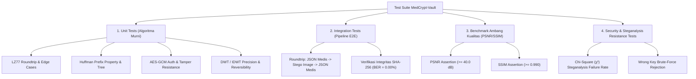

# Testing & Quality Assurance Plan (TESTING)
## MedCrypt-Vault: Test Strategy & Verification Specifications

---

### 1. Test Strategy Overview

Strategi pengujian MedCrypt-Vault menggunakan pendekatan berlapis (*Multi-Layer Verification Strategy*) untuk memastikan seluruh modul algoritma bekerja dengan presisi matematis tinggi tanpa ada kecacatan data klinis.



---

### 2. Detailed Test Cases Matrix

#### 2.1. Modul Kompresi Data (LZ77 & Huffman)

| ID Uji | Target Modul | Prosedur Pengujian | Kriteria Lolos (*Pass Condition*) |
| :--- | :--- | :--- | :--- |
| **TC-COMP-01** | `lz77.py` | Mengompresi string umum dengan repetisi tinggi (contoh: `"TOBEORNOTTOBEORTOBEORNOT"`), lalu mendekompresinya. | Output dekompresi identik 100% dengan teks asal. Ukuran token $<$ ukuran asal. |
| **TC-COMP-02** | `lz77.py` | Menguji batas buffer: memasukkan berkas acak berukuran $> 64\text{ KB}$ (melewati batas sliding window 32 KB). | Algoritma menggeser window tanpa overflow atau *memory leak*, hasil rekonstruksi utuh. |
| **TC-COMP-03** | `lz77.py` | Menguji string acak tanpa repetisi sama sekali (worst-case). | Algoritma menghasilkan deretan token literal tanpa crash. |
| **TC-COMP-04** | `huffman.py` | Membangun pohon Huffman dari distribusi frekuensi acak. | **Prefix Property Terpenuhi:** Tidak ada codeword biner yang menjadi prefix dari codeword lain. |
| **TC-COMP-05** | `huffman.py` | Serialisasi bit-length kanonikal dan rekonstruksi codeword di sisi dekoder. | Codeword hasil rekonstruksi kanonikal dekoder sama persis dengan encoder. |

---

#### 2.2. Modul Kriptografi & Keamanan

| ID Uji | Target Modul | Prosedur Pengujian | Kriteria Lolos (*Pass Condition*) |
| :--- | :--- | :--- | :--- |
| **TC-SEC-01** | `cipher.py` | Enkripsi dan dekripsi berkas JSON rekam medis dengan kunci yang benar. | Data terdekripsi 100% identik (SHA-256 cocok). |
| **TC-SEC-02** | `cipher.py` | Dekripsi berkas dengan memasukkan passphrase yang salah (bahkan beda 1 karakter). | Sistem menolak dekripsi dan melempar `InvalidTagException` (otentikasi gagal). |
| **TC-SEC-03** | `cipher.py` | Memodifikasi 1 bit ciphertext secara sengaja (*tamper attack*). | Tag GCM mendeteksi pemalsuan bit dan menolak proses dekripsi. |
| **TC-SEC-04** | `framing.py` | Memeriksa pembacaan Magic Header `MCVT`. | Berkas tanpa magic header valid langsung ditolak dengan pesan kesalahan jelas. |

---

#### 2.3. Modul Steganografi 2D-DWT & Rekonstruksi

| ID Uji | Target Modul | Prosedur Pengujian | Kriteria Lolos (*Pass Condition*) |
| :--- | :--- | :--- | :--- |
| **TC-STEGO-01** | `dwt.py` | Transformasi 2D Haar DWT dilanjutkan IDWT pada citra medis tanpa penyisipan data. | Deviasi numerik rekonstruksi $< 10^{-5}$ (lossless matematis). |
| **TC-STEGO-02** | `embedder.py` | Menyisipkan bit biner payload ke sub-band $LH$ dan $HL$ dengan faktor langkah $\Delta = 4$. | Bit yang diekstrak kembali oleh `extractor.py` memiliki **Bit Error Rate (BER) = 0.00%**. |
| **TC-STEGO-03** | `embedder.py` | Memverifikasi koefisien sub-band $LL$ (organ tubuh vital). | **Matriks $LL$ tidak mengalami perubahan nilai sama sekali** ($LL_{\text{cover}} == LL_{\text{stego}}$). |
| **TC-STEGO-04** | `embedder.py` | Uji kapasitas berlebih (*Capacity Overflow*): menyisipkan muatan yang lebih besar dari jumlah koefisien $LH+HL$. | Sistem melempar `CapacityExceededError` sebelum memodifikasi citra. |

---

#### 2.4. Modul Benchmark Ambang Kualitas & Steganalisis

| ID Uji | Target Modul | Prosedur Pengujian | Kriteria Lolos (*Pass Condition*) |
| :--- | :--- | :--- | :--- |
| **TC-QUAL-01** | `quality.py` | Menghitung PSNR antara citra rontgen cover ($512 \times 512$) vs citra stego. | **PSNR $\ge$ 40.0 dB** (Kategori Sangat Baik / Bebas Distorsi Visual). |
| **TC-QUAL-02** | `quality.py` | Menghitung SSIM dengan jendela Gaussian $11 \times 11$. | **SSIM $\ge$ 0.990** (Struktur citra $> 99\%$ identik secara visual). |
| **TC-QUAL-03** | `steganalysis.py` | Menjalankan uji $\chi^2$ (Chi-Square) pada histogram pasangan nilai piksel (PoVs) citra stego. | Nilai $p\text{-value} > 0.05$ (Penyisipan DWT tidak memicu anomali statistik steganografi). |

---

### 3. Otomasi Pengujian & Perintah Eksekusi

Pengujian dijalankan secara otomatis menggunakan pustaka `pytest`. Perintah eksekusi:

```bash
# Menjalankan seluruh test suite dengan laporan verbose
pytest tests/ -v

# Menjalankan pengujian spesifik modul kompresi
pytest tests/test_compression.py -v

# Menjalankan pengujian kualitas citra dan steganografi DWT
pytest tests/test_steganography.py -v

# Menjalankan uji benchmark kualitas (PSNR & SSIM assertion)
pytest tests/test_quality_benchmarks.py -v --tb=short
```

### 4. Kriteria Kelulusan Akhir Proyek (*Definition of Done*)
1. Seluruh pengujian pada test suite menghasilkan status **PASSED (100%)**.
2. Nilai Bit Error Rate (**BER**) pada pengujian roundtrip rekam medis adalah **0.00%**.
3. Nilai **PSNR $\ge 40.0\text{ dB}$** dan **SSIM $\ge 0.990$** pada seluruh dataset sampel citra radiologi uji.
4. Nilai $p\text{-value}$ uji Chi-Square tetap berada di atas $0.05$ (lolos uji forensik).
