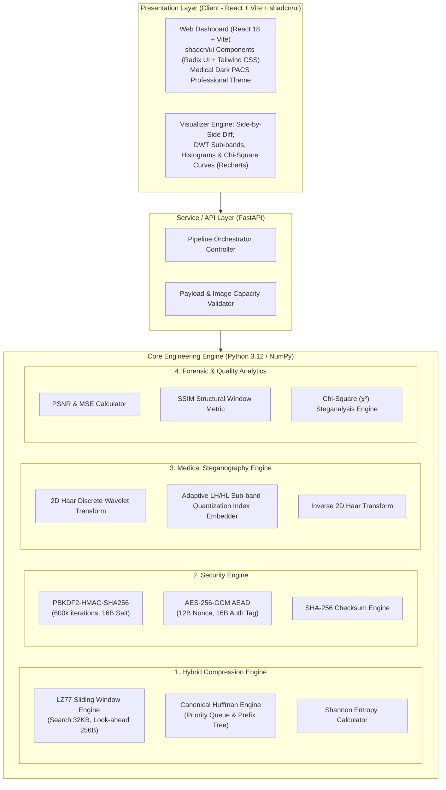

# Technical Requirements Document (TRD)
## MedCrypt-Vault: Technical Architecture & Algorithm Specifications

---

### 1. High-Level Technical Architecture

Arsitektur MedCrypt-Vault dirancang secara modular dengan pemisahan tegas antara **Core Engineering Engine** (algoritma kompresi, kriptografi, steganografi citra), **API Layer** (FastAPI backend), dan **Presentation Layer** (Web Dashboard).

---

### 2. Algorithmic Specifications

#### 2.1. Perhitungan Shannon Entropy ($\mathcal{H}$)
Sesuai materi **Modul 1 & 2**, derajat keacakan dan batas teoritis kompresi data dihitung dengan:
$$\mathcal{H}(S) = - \sum_{i=1}^{n} p(s_i) \log_2 p(s_i)$$
- Untuk citra 8-bit ($0 \dots 255$): Probabilitas $p(g) = \frac{\text{count}(g)}{W \times H}$. Entropi teoritis maksimum adalah $\log_2(256) = 8.0\text{ bit/piksel}$.
- Untuk payload bitstream terkompresi & terenkripsi: Entropi mendekati $7.99 - 8.0\text{ bit/byte}$, mengindikasikan ketiadaan pola redundan.

#### 2.2. Engine Kompresi LZ77 (Modul 6)
- **Struktur Penyangga (*Buffer*):**
  - Ukuran *Search Buffer* ($W_s$): $32\text{ KB}$ ($32.768\text{ byte}$).
  - Ukuran *Look-Ahead Buffer* ($W_l$): $256\text{ byte}$.
- **Spesifikasi Token Keluaran:**
  - `Match Token`: Pasangan `(offset, length)` di mana $offset \in [1, 32768]$ dan $length \in [3, 256]$.
  - `Literal Token`: `(0, 0, byte)` untuk karakter yang tidak ditemukan kecocokannya pada search buffer.
- **Strategi Optimasi Pencarian:** Menggunakan *Hash-chaining* pada 3-gram byte pertama untuk mempercepat pencarian kecocokan string terpanjang (*Longest Common Prefix*) dari $O(N \cdot W_s)$ menjadi $O(N)$.

#### 2.3. Engine Canonical Huffman Coding (Modul 4)
- **Konstruksi Pohon:** Min-Heap priority queue berdasarkan frekuensi kemunculan token LZ77.
- **Prefix Property Verification:** Setiap simpul daun menerima codeword biner sedemikian rupa sehingga tidak ada codeword yang menjadi awalan dari codeword lain.
- **Bentuk Kanonikal (*Canonical Huffman*):**
  Alih-alih menyimpan seluruh struktur pohon biner ke dalam payload (yang memakan ruang), algoritma hanya menyimpan array panjang bit (*bit-length array*) untuk setiap simbol. Codeword dihitung ulang secara deterministik oleh dekoder berdasarkan aturan leksikografis kanonikal.

#### 2.4. Kriptografi Berlapis (AES-256-GCM)
- **Key Derivation Function (KDF):**
  $$K_{\text{enc}} = \text{PBKDF2}(\text{Passphrase}, \text{Salt}_{16\text{B}}, c=600000, \text{hash}=\text{SHA-256})$$
- **Enkripsi:**
  $$C, T = \text{AES-256-GCM-Encrypt}(K_{\text{enc}}, \text{IV}_{12\text{B}}, \text{CompressedData}, \text{AAD})$$
  - Di mana $C$ = Ciphertext, $T$ = 16-byte Authentication Tag (menjamin data tidak dimanipulasi), AAD = Metadata header medis.

#### 2.5. Steganografi 2D-Discrete Wavelet Transform (2D-DWT)
Citra medis berdimensi $M \times N$ ditransformasi menggunakan tapis Haar Wavelet:
- **Analisis Filter Haar:**
  - Filter lolos-rendah (*Low-pass filter*): $h_L = [\frac{1}{\sqrt{2}}, \frac{1}{\sqrt{2}}]$
  - Filter lolos-tinggi (*High-pass filter*): $h_H = [\frac{1}{\sqrt{2}}, -\frac{1}{\sqrt{2}}]$
- **Dekomposisi Sub-Band:**
  $$\text{DWT}(I) = \begin{bmatrix} LL & HL \\ LH & HH \end{bmatrix}$$
  - $LL$ ($\frac{M}{2} \times \frac{N}{2}$): Representasi aproksimasi kasar (struktur organ vital). **Dilarang disisipi bit**.
  - $HL$ ($\frac{M}{2} \times \frac{N}{2}$): Detail frekuensi vertikal.
  - $LH$ ($\frac{M}{2} \times \frac{N}{2}$): Detail frekuensi horizontal.
  - $HH$ ($\frac{M}{2} \times \frac{N}{2}$): Detail frekuensi diagonal.
- **Aturan Penyisipan Adaptif (*Quantization Index Modulation* / QIM pada Sub-band LH dan HL):**
  Untuk koefisien $c \in LH \cup HL$:
  $$c' = \begin{cases} 
  \text{round}\left(\frac{c}{\Delta}\right) \cdot \Delta + \frac{\Delta}{4}, & \text{jika bit payload} = 0 \\ 
  \text{round}\left(\frac{c}{\Delta}\right) \cdot \Delta + \frac{3\Delta}{4}, & \text{jika bit payload} = 1 
  \end{cases}$$
  Di mana $\Delta$ adalah faktor langkah kuantisasi (*quantization step* $\Delta \in [2, 6]$). Nilai $\Delta = 4$ memberikan rasio optimal antara ketahanan dan imperseptibilitas ($PSNR > 42\text{ dB}$).
- **Rekonstruksi:** Citra stego dibentuk kembali menggunakan 2D-Inverse DWT (2D-IDWT) dan dipotong nilainya ke rentang integer $[0, 255]$.

#### 2.6. Metrik Kualitas Citra & Forensik (Sesi 6 & Modul 9/10)

1. **Mean Squared Error (MSE):**
   $$\text{MSE} = \frac{1}{M \cdot N} \sum_{x=0}^{M-1} \sum_{y=0}^{N-1} [I(x,y) - I'(x,y)]^2$$
2. **Peak Signal-to-Noise Ratio (PSNR):**
   $$\text{PSNR} = 10 \cdot \log_{10} \left( \frac{\text{MAX}_I^2}{\text{MSE}} \right) = 10 \cdot \log_{10} \left( \frac{255^2}{\text{MSE}} \right)$$
   - *Target Kualitas Klinis:* $\mathbf{PSNR \ge 40.0\text{ dB}}$ (Secara medis dianggap identik dan tidak terdeteksi mata manusia).
3. **Structural Similarity Index (SSIM):**
   $$\text{SSIM}(x,y) = \frac{(2\mu_x\mu_y + C_1)(2\sigma_{xy} + C_2)}{(\mu_x^2 + \mu_y^2 + C_1)(\sigma_x^2 + \sigma_y^2 + C_2)}$$
   - *Target Kualitas Klinis:* $\mathbf{SSIM \ge 0.990}$.
4. **Uji Forensik Chi-Square ($\chi^2$ Steganalysis):**
   Mendeteksi pergeseran frekuensi pasangan nilai piksel bertetangga (*Pairs of Values*):
   $$\chi^2 = \sum_{k=1}^{128} \frac{(n_{2k} - n_{2k+1}^*)^2}{n_{2k+1}^*}, \quad \text{di mana } n_{2k+1}^* = \frac{n_{2k} + n_{2k+1}}{2}$$
   - *Target Keamanan:* $p\text{-value} > 0.05$ (Hipotesis nol tidak ditolak $\to$ berkas dinyatakan **bebas dari anomali steganografi LSB/frekuensi**).

---

### 3. Binary Payload Framing Specification

Sebelum disisipkan ke dalam koefisien DWT citra, paket biner disusun dalam frame terstruktur:

| Offset Byte | Panjang (Byte) | Field | Keterangan |
| :--- | :--- | :--- | :--- |
| `0x00` | 4 | Magic Header | ASCII Identitas: `MCVT` (*MedCrypt Vault*) |
| `0x04` | 2 | Version Flag | Major/Minor Version: `0x0100` |
| `0x06` | 16 | Salt | Salt acak untuk KDF PBKDF2 |
| `0x16` | 12 | Nonce / IV | Nonce acak untuk AES-256-GCM |
| `0x22` | 4 | Compressed Size | Panjang ciphertext terkompresi ($N$ byte) |
| `0x26` | 4 | Original Size | Panjang berkas rekam medis asli |
| `0x2A` | 16 | Auth Tag | Authentication Tag dari AES-GCM |
| `0x3A` | 32 | SHA-256 Hash | Hash integritas data rekam medis asli |
| `0x5A` | $N$ | Encrypted Payload | Ciphertext hasil enkripsi data terkompresi |

Total *header overhead* adalah 90 byte, yang dengan mudah ditampung oleh citra beresolusi sedang (citra $512 \times 512$ memiliki kapasitas teoritis sub-band $LH+HL \approx 131.072\text{ koefisien} \approx 16.384\text{ byte}$).

---

### 4. Hardware & Software Requirements

- **Runtime:** Python 3.12.6 (Backend Core), Node.js v24.14.0 & npm (Frontend UI) on Windows / Linux / macOS.
- **Backend Core Dependencies:**
  - `numpy >= 1.26.0` (komputasi matriks dan vektorisasi sinyal).
  - `PyWavelets >= 1.5.0` (komputasi 2D DWT/IDWT).
  - `opencv-python-headless >= 4.9.0` (manipulasi citra presisi tinggi).
  - `cryptography >= 42.0.0` (primitif kriptografi AES-GCM dan KDF).
  - `fastapi >= 0.110.0` & `uvicorn >= 0.28.0` (backend REST API).
- **Frontend UI Architecture (shadcn/ui Design System):**
  - **Framework:** React 18 / Vite with TypeScript.
  - **Styling:** Tailwind CSS (Slate / Zinc Medical Dark Theme).
  - **Component Library:** **shadcn/ui** (berbasis Radix UI primitives):
    - `Tabs` (navigasi mode Encode, Decode, Forensic).
    - `Card`, `CardHeader`, `CardTitle`, `CardContent` (wadah panel kerja dan metrik).
    - `Button`, `Badge` (indikator status kripto dan aksi eksekusi).
    - `Slider` (kontrol langkah kuantisasi $\Delta$ dan transparansi diff viewer).
    - `Progress` (indikator tahapan kompresi & steganografi live).
    - `Dialog` / `Modal` (inspeksi mendalam sub-band DWT).
    - `Sonner` / `Toast` (notifikasi modern).
    - `Table` (rincian token kompresi dan buku besar audit).
  - **Icons & Visuals:** `lucide-react` (ikon-ikon medis & keamanan siber).
  - **Charts & Graphs:** `recharts` / shadcn chart (grafik kurva Chi-square, histogram, dan rasio kompresi).
- **Kebutuhan Memori:** Minimum 2 GB RAM (rekomendasi 4 GB untuk pemrosesan citra 4K DICOM/PNG).
